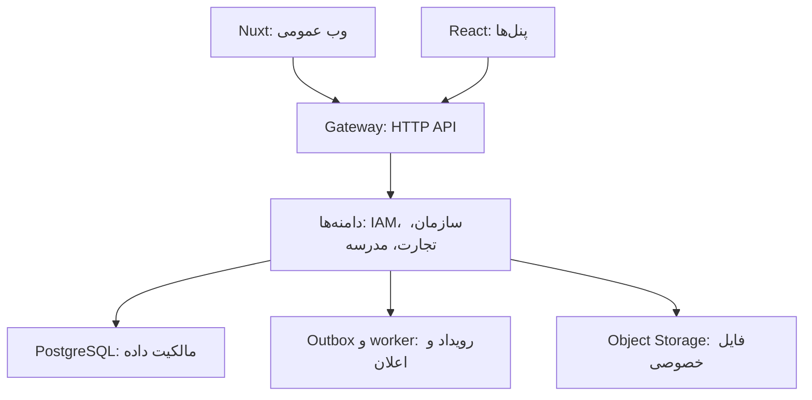
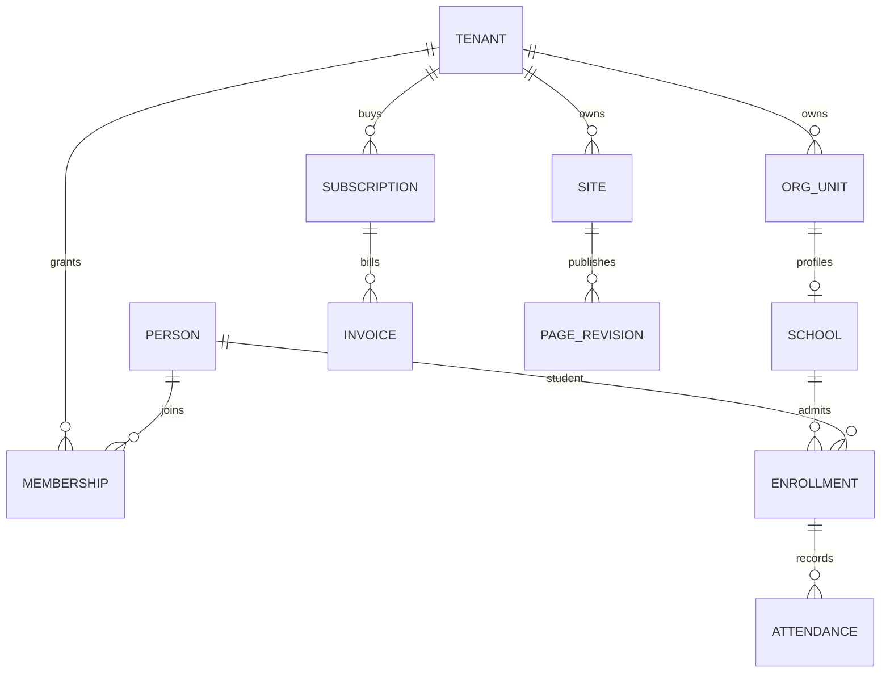

# پروپوزال مهندسی eduapp

**نسخه:** ۲٫۱ پیشنهادی | **وضعیت:** مبنای تصمیم و برآورد، بدون ادعای پیاده‌سازی | **مخزن کد هدف:** `ostaddehdari/eduapp`

## ۱. منشأ تصمیم‌ها و حدود شواهد

- **منبع اصلی بررسی‌شده:** فایل پیوست `EduSaaS_Engineering_Blueprint_v2.0 (1).docx`، نسخه ۲٫۰ مورخ ۱۴۰۵/۰۸/۲۷. متن پیوست خودش به HAR و بسته Starter Engineering Pack اشاره می‌کند؛ فایل خام HAR و آن بسته به این درخواست پیوست نشده‌اند و در این سند اعتبارسنجی نشده‌اند.
- **وضعیت مخزن هنگام بررسی:** `eduapp` یک مخزن عمومی با README مربوط به پل عملیاتی Ubuntu و پیش‌نمایش ایستا بود. کارفرما صریحاً خواست محتوای کنونی پاک شود و همین مخزن برای ساخت پروژه جدید استفاده شود. هیچ یک از امکانات آن README به‌عنوان زیرساخت آماده محصول فرض نمی‌شود.
- **تصمیم‌های تصریح‌شده در سند مبنا:** Backend مستقل و Headless با NestJS/TypeScript، PostgreSQL، جداسازی Tenant، API-First، Nuxt برای وب عمومی، React برای پنل، اولویت P0 برای هویت/سازمان/اشتراک پلتفرم و P1 برای مدرسه/حضور/اعلان. **گزینه پیشنهادی بازنگری:** تعداد سرویس‌های عملیاتی و ضرورت Redis/RabbitMQ در Sprint 0 با اندازه تیم، بار و هزینه عملیاتی تصویب شود؛ مرزهای منطقی از ابتدا ثابت بمانند.
- **تصمیم‌های باز:** مکان و مقررات استقرار، مالکیت پردازش داده کودکان و رضایت سرپرست، ارائه‌دهنده درگاه/پیامک/فایل، توان سامانه مالی موجود، مدل قیمت، بودجه، ظرفیت، روش IAM، ORM و SLA. هیچ قرارداد یا کارکردی برای ارائه‌دهندگان بیرونی تضمین نشده است.

## ۲. مسئله، نتیجه و محدوده

یک پلتفرم SaaS برای هلدینگ آموزشی، مدرسه مستقل یا شعبه‌دار و آموزشگاه ساخته شود که مالک پلتفرم بتواند Tenant ایجاد کند، پلن بفروشد، سازمان و مدرسه را تعریف کند، دسترسی محدود تفویض کند و وب‌سایت اختصاصی منتشر کند. مدیر مدرسه بعداً سال، کلاس، معلم، دانش‌آموز و سرپرست را ثبت می‌کند؛ غیبت تأییدشده با سیاست مدرسه به سرپرست مجاز اطلاع داده می‌شود.

**معیار پذیرش کسب‌وکار برای انتشار:** سناریوی انتهابه‌انتهای Tenant جدید → خرید تأییدشده → سازمان مستقل/چندشعبه‌ای → نقش و فیلد سفارشی → سایت منتشرشده → ثبت‌نام و کلاس → حضور تأییدشده → اعلان مجاز، در staging با دو Tenant مستقل انجام شود؛ تست‌های نشت بین Tenant، پرداخت تکراری و اعلان تکراری سبز باشند. نرخ انجام موفق این سناریو و زمان تکمیل هر گام در پایلوت اندازه‌گیری شود؛ آستانه نهایی پیش از قرارداد پایلوت تعیین شود.

**MVP تجاری P0:** احراز هویت/عضویت/مجوز، Tenant و درخت سازمان، فیلد سفارشی محدود، پلن/صورتحساب/درگاه/حق دسترسی، دارایی فایل خصوصی، ثبت سایت و زیردامنه. **انتشار کامل نسخه اول P1:** صفحه‌ساز و دامنه، هسته مدرسه، سرپرستی، حضور معلم/دستگاه منتخب و اعلان. این دو Gate مجزا هستند؛ فروش نسخه P0 نباید امکانات P1 را وعده دهد.

**خارج از محدوده نسخه اول:** حسابداری و حقوق مدرسه، کیف پول/بوفه، آزمون آنلاین، کلاس زنده، هوش مصنوعی، پردازش بیومتریک خام، پیام‌رسان بدون API معتبر، و پشتیبانی قطعی برای همراه اول/اسنپ‌پی بدون قرارداد و POC. اتصال مشاهده‌ای به سامانه مالی مدرسه در P1 پس از احراز API و مجوز دسترسی.

## ۳. بازیگران و سفرها

| بازیگر | دامنه مجاز | مسیر حیاتی |
|---|---|---|
| مالک پلتفرم | مدیریت Tenant/پلن با مجوز ویژه و ثبت ممیزی | ایجاد Tenant، تصویب پلن، مشاهده پرداخت تأییدشده |
| مالک Tenant / مدیر مجموعه | سازمان، زیرشاخه‌های مجاز، اشتراک و واگذاری | ساخت مدرسه مستقل یا شعبه، دعوت مدیر، محدودکردن scope |
| مدیر مدرسه / معاون | سال، کلاس، کاربران و حضور همان مدرسه | تعریف سال و کلاس، تأیید/اصلاح حضور |
| معلم | کلاس و جلسه دارای انتساب معتبر | ثبت حضور گروهی و مشاهده نتیجه |
| سرپرست / دانش‌آموز | پرونده مرتبط و فیلدهای مجاز | مشاهده فرزند و پیام بدون افشای داده سایر فرزندان |
| مدیر سایت تفویضی | صفحات و دارایی‌های مصرح در قرارداد، تا انقضا | ویرایش پیش‌نویس و انتشار فقط در صورت مجوز مستقل |
| سرویس/دستگاه | scope و credential محدود | ارسال رویداد امضاشده، دریافت رسید، بدون دسترسی عمومی |

## ۴. الزامات دارای شناسه پایدار

هر سطر یک معیار پذیرش قابل اجرا دارد؛ جزئیات سناریوی منفی در بخش آزمون آمده است. ورودی نامعتبر `400/422`، تعارض `409`، احراز ناموفق `401` و مجوز نامعتبر `403` یا `404` بدون افشای وجود شیء برمی‌گرداند.

| شناسه | اولویت | الزام و ورودی → خروجی | پذیرش |
|---|---|---|---|
| FR-001 | Must P0 | ورود با رمز/OTP، انتخاب عضویت و چرخه نشست → context معتبر | ورود تکراری و OTP منقضی رد؛ refresh تکراری نشست را باطل می‌کند؛ تغییر Tenant مستلزم عضویت فعال است. |
| FR-002 | Must P0 | نقش، scope، رابطه سرپرستی، entitlement → تصمیم دسترسی | کاربر Tenant A و مدیر شعبه A با شناسه B هر دو رد شوند؛ مجوز و پلن هر دو مستقل بررسی شوند. |
| FR-003 | Must P0 | ایجاد Tenant و جابه‌جایی org unit → درخت نسخه‌دار | parent خارج Tenant، چرخه، و تکرار کد در یک parent رد؛ مدرسه بدون شعبه و شعبه‌دار پشتیبانی شود. |
| FR-004 | Must P0 | دعوت/عضویت چندسازمانی → نقش فعال در محدوده | یک شخص در دو Tenant نقش متفاوت دارد و تغییر context به هیچ وجه مجوز قبلی را حمل نمی‌کند. |
| FR-005 | Must P0 | تعریف/ثبت فیلد سفارشی → مقدار اعتبارسنجی‌شده | کلید رزروشده و JavaScript رد؛ تغییر schema نسخه جدید دارد؛ مقدار قبلی قابل خواندن و ممیزی است. |
| FR-006 | Must P0 | پلن، صورتحساب، تلاش پرداخت و وب‌هوک → entitlement | وب‌هوک با امضا/استعلام معتبر فعال می‌کند؛ پنج تکرار فقط یک پرداخت و یک تخصیص ثبت می‌کند. |
| FR-007 | Must P0 | قرارداد واگذاری مدیریت → grant محدود | مالک محدوده را تأیید کند؛ انقضا/لغو فوراً اثر کند؛ مالکیت داده و پرداخت‌کننده تغییر نکند. |
| FR-008 | Must P0 | upload session و تکمیل → asset خصوصی | quota، hash، MIME و اسکن معتبر؛ فایل خصوصی از URL عمومی CDN قابل خواندن نباشد. |
| FR-009 | Must P0 | ایجاد سایت/زیردامنه و اثبات دامنه → host فعال | نام دامنه بدون اثبات مالکیت فعال نشود؛ Host دست‌کاری‌شده Tenant را عوض نکند. |
| FR-010 | Must P1 | JSON draft و publish → revision immutable و سایت Nuxt | داده خارج schema/اسکریپت رد؛ انتشار نسخه‌دار و rollback سالم؛ تعارض ویرایش همزمان `409`. |
| FR-011 | Must P1 | سال/کلاس/معلم/دانش‌آموز/ثبت‌نام → تاریخچه سالانه | کلاس به همان مدرسه/سال متعلق باشد؛ انتقال سال، پرونده و سابقه پیشین را حذف نکند. |
| FR-012 | Must P1 | رابطه سرپرستی تأییدشده → دیدن فرزند | سرپرست فقط فرزند پیوندخورده و فیلد مجاز را ببیند؛ رابطه لغوشده فوراً رد شود. |
| FR-013 | Must P1 | ثبت گروهی معلم/رویداد دستگاه → حضور موقت/تأییدشده | معلم غیرمنتسب رد؛ `(tenant,device,external_event)` یکتا؛ تردد گیت، حضور کلاس محسوب نشود. |
| FR-014 | Must P1 | حضور تأییدشده و rule → job و receipt | قبل از تأیید طبق سیاست صفر پیام؛ retry و تکرار event فقط یک اعلان منطقی؛ سکوت زمانی رعایت شود. |
| FR-015 | Should P1 | داده مالی خارجی → snapshot فقط خواندنی | منشأ و `last_synced_at` نمایش داده شود؛ خطای sync به تغییر مانده یا وصول محلی منجر نشود. |

| شناسه | اولویت | الزام غیرفنی/امنیتی/داده/عملیات | معیار پذیرش |
|---|---|---|---|
| NFR-001 | Must | جداسازی و تحمل بار در staging | تست Tenant A/B در API، DB، cache، queue، فایل و export صفر نشت؛ پروفایل بار ۱۰۰/۵۰۰/۱۰۰۰ کاربر همزمان با داده پایلوت گزارش شود. |
| NFR-002 | Should | دسترس‌پذیری و تأخیر هدف پایلوت | هدف اولیه API هسته ۹۹٫۹٪ ماهانه، خواندن رایج p95 < ۴۰۰ms و پذیرش حضور p95 < ۷۰۰ms **فقط زیر بار تعریف‌شده و خارج از زمان provider**؛ سنجه واقعی و هزینه قبل از SLA تصویب شود. |
| NFR-003 | Must | فارسی/RTL و دسترس‌پذیری | تاریخ UTC در API، نمایش جلالی در UI، کیبورد و فوکوس در مسیرهای اصلی و بررسی WCAG 2.2 AA متناسب با وب. |
| SEC-001 | Must | مجوز شیءمحور و انکار پیش‌فرض | ماتریس نقش × عمل × شیء × scope × entitlement با سناریوهای منفی خودکار؛ هیچ شناسه‌ای از Header/URL بدون اعتبارسنجی مالکیت پذیرفته نشود. |
| SEC-002 | Must | هویت، نشست و حریم خصوصی کودکان | MFA مدیر حساس، revoke/rotation نشست، ثبت رضایت و حداقل داده؛ هیچ الگوی بیومتریک خام در SaaS نگهداری نشود. |
| SEC-003 | Must | کنترل ورودی، فایل، خروجی و اسرار | اسکن وابستگی و secret، CSRF کوکی، XSS/CSP، SSRF allowlist، MIME/size/scan، TLS؛ تست سوءاستفاده‌های بحرانی سبز. |
| DATA-001 | Must | مدل مالکیت و سازگاری | `tenant_id NOT NULL` روی جدول Tenant-owned، FK مرکب در DB مشترک، migration/RLS و تست pooling؛ تراکنش مالی idempotent. |
| DATA-002 | Must | پشتیبان/حذف/بازیابی | بازیابی در staging آزموده و RPO/RTO ثبت شود؛ برنامه حذف/retention فایل، DB، backup و audit قبل از تولید تصویب شود. |
| OPS-001 | Must | CI و تحویل | format/lint/typecheck/unit/integration/contract/security/build همگی سبز و artefact امضاشده/قابل ردیابی؛ staging و rollback آزمایش شده. |
| OPS-002 | Must | مشاهده‌پذیری و تفکیک محیط | trace/request ID، metrics، health/readiness، لاگ بدون PII، secret جدا برای dev/staging/prod و هشدار خطای پرداخت/queue. |

## ۵. معماری و تصمیم‌ها

**مرزها:** Gateway احراز هویت، rate limit و routing را انجام می‌دهد؛ سرویس یا ماژول مالک منبع همواره authorization نهایی را اجرا می‌کند. اپ‌های Nuxt/React فقط قرارداد HTTP را مصرف می‌کنند، بدون query مستقیم DB یا business logic در SSR. دامنه‌های منطقی: IAM/Access، Tenancy/Organization، Persons/Fields، Commercial/Billing، Sites/Pages/Domains، Assets، School/Enrollment، Attendance، Notifications/Integrations، Audit/Jobs. اشتراک کد فقط برای قرارداد، value object و ابزار عمومی؛ هیچ repository/ORM مشترک برای جدول‌های دامنه‌های مختلف.

**ADR-001، شکل استقرار:** سند ۲٫۰ حدود ۸ تا ۱۰ deployment اولیه پیشنهاد می‌کند. پیشنهاد تکمیلی برای آغاز: ابتدا API ماژولار NestJS، worker، Nuxt و React با مرزهای بسته‌ای روشن؛ جداسازی IAM/مالی/حضور به runtime مستقل زمانی که بار، تیم، SLA یا نیاز امنیتی آن را توجیه کند. گزینه ۸ تا ۱۰ سرویس پس از POC قابل انتخاب است؛ هزینه شبکه، broker، observability و هماهنگی schema در برآورد لحاظ شود. API و رویداد نسخه‌دار مانع قفل‌شدن معماری می‌شوند.

**ADR-002، ذخیره داده:** PostgreSQL برای تراکنش/سازگاری و JSONB محدود فیلدهای سفارشی. Tenant row-based با `tenant_id` و RLS دفاع تکمیلی؛ در صورت جداسازی دیتابیس سرویس، ownership و API/Event contract همان می‌مانند. NoSQL برای داده تراکنشی بدون benchmark وارد نشود.

**ADR-003، async:** outbox در همان transaction داده تجاری نوشته شود؛ worker با inbox/dedupe، backoff و dead-letter پس از سقف retry. RabbitMQ طبق سند مبنا گزینه صف است؛ Sprint 0 هزینه و نیاز واقعی را برای استقرار اولیه تعیین کند. Redis صرفاً cache/rate limit و داده قابل بازسازی؛ source of truth نیست.

**ADR-004، فناوری:** NestJS/TypeScript strict، PostgreSQL، Nuxt و React/Vite مطابق فایل مبنا. ORM از میان Prisma/Drizzle پس از POC برای RLS، migration و transaction انتخاب شود. نسخه دقیق framework/runtime پس از compatibility/security review پین می‌شود. provider فایل generic S3 نقطه شروع؛ Arvan و MCI فقط پس از تست واقعی.

**ADR-005، سیاست تجاری:** `entitlement` و `permission` مستقل؛ پرداخت نهایی با استعلام سرور و ledger ثبت می‌شود؛ اشتراک منقضی داده را فوراً پاک نمی‌کند. مالی مدرسه دامنه جدا و در نسخه اول صرفاً اتصال مشاهده‌ای است.

**پوشه‌های کد در شروع واقعی:** `apps/api`, `apps/worker`, `apps/public-web`, `apps/control-panel`, `packages/contracts`, `packages/ui-tokens`, `packages/adapter-interfaces`, `docs/adr`, `docs/runbooks`, `infra/`. اگر سرویس split شد، package/API ownership حفظ شود؛ workflow استقرار قبلی مخزن مبنای تولید نیست.

## ۶. ERD و فرهنگ داده عملیاتی

فرهنگ زیر حداقل فیلدها را مشخص می‌کند؛ ستون‌های `created_at timestamptz NOT NULL DEFAULT now()`، `updated_at` و `version bigint NOT NULL DEFAULT 1` در جدول‌های قابل ویرایش اضافه می‌شوند؛ `tenant_id uuid NOT NULL` بر تمام جدول‌های مالک Tenant اعمال می‌شود، مگر `tenants` و کاتالوگ سراسری. UUID، کدها و تاریخ در DB معتبرسازی می‌شوند؛ تمام timestampها UTC. PII در توسعه/CI با داده ساختگی جایگزین می‌شود.

| موجودیت و مالک | ستون‌های اصلی (نوع؛ قید) | رابطه، شاخص و سیاست داده |
|---|---|---|
| `tenants` / tenancy | `id uuid PK`, `slug text UNIQUE NOT NULL`, `status text CHECK`, `deleted_at timestamptz NULL` | نگهداری بر اساس قرارداد و درخواست حذف؛ وضعیت تعلیق بدون حذف خودکار. |
| `org_units` / tenancy | `id uuid PK`, `tenant_id uuid FK`, `parent_id uuid NULL`, `kind text CHECK`, `code text NOT NULL` | FK `(tenant_id,parent_id)` به `(tenant_id,id)`؛ unique کد در parent و root partial unique؛ جابه‌جایی بدون چرخه؛ `(tenant_id,parent_id)` index. |
| `identities` / iam | `id uuid PK`, `login_normalized text UNIQUE`, `status text` | شناسه ورود/تماس PII؛ از `persons` جدا؛ لاگین بدون جست‌وجوی Tenant آزاد. |
| `sessions` / iam | `id uuid PK`, `identity_id uuid FK`, `refresh_hash text`, `expires_at timestamptz`, `revoked_at timestamptz NULL` | فقط hash توکن؛ index `(identity_id,expires_at)`؛ purge پس از TTL/سیاست. |
| `persons` / people | `id uuid PK`, `tenant_id uuid FK`, `identity_id uuid NULL`, `display_name text` | داده کودک/سرپرست حساس؛ هویت سراسری به اشتراک داده بین Tenant منجر نشود؛ lookup با `tenant_id`. |
| `memberships` / access | `id uuid PK`, `tenant_id uuid FK`, `identity_id uuid FK`, `org_unit_id uuid NULL`, `status text`, `expires_at timestamptz NULL` | unique فعال برای هویت/محدوده/نوع عضویت؛ `(tenant_id,identity_id,status)`؛ مجوز زمینه‌ای. |
| `roles` و `role_bindings` / access | role: `id`, `tenant_id`, `name`, `version`; binding: `id`, `tenant_id`, `membership_id`, `role_id`, `scope_org_id`, `expires_at` | FKهای مرکب Tenant؛ deny precedence و history نقش؛ شناسه role به‌تنهایی مجوز نیست. |
| `field_definitions` و `field_values` / fields | definition: `id`, `tenant_id`, `entity_type`, `key`, `schema_version`, `sensitivity`; value: `tenant_id`, `entity_id`, `definition_id`, `value_jsonb` | unique `(tenant_id,entity_type,key,schema_version)` و `(tenant_id,entity_id,definition_id)`؛ PII طبقه‌بندی‌شده، حجم/عمق JSON محدود. |
| `plans`, `plan_versions`, `entitlements` / billing | plan `id`, `code`; version `id`, `plan_id`, `price_minor bigint`, `currency`, `effective_at`; entitlement `id`, `tenant_id`, `feature`, `limit_value`, `valid_to` | catalog version immutable؛ entitlement منبع تصمیم بلادرنگ؛ index `(tenant_id,feature,valid_to)`. |
| `subscriptions`, `invoices` / billing | subscription: `id`, `tenant_id`, `plan_version_id`, `status`; invoice: `id`, `tenant_id`, `subscription_id`, `amount_minor bigint`, `currency`, `status` | شماره فاکتور unique در قلمرو قانونی/تجاری مصوب؛ عدد صحیح کوچک‌ترین واحد ارز. |
| `payment_attempts`, `provider_events`, `ledger_entries` / billing | attempt `id`, `tenant_id`, `invoice_id`, `idempotency_key`; event `provider`, `provider_event_id`, `payload_hash`; ledger `id`, `tenant_id`, `invoice_id`, `direction`, `amount_minor` | unique `(tenant_id,idempotency_key)` و `(provider,provider_event_id)`؛ ledger append-only و reconciliation؛ گزارش بدون شماره کارت. |
| `sites`, `domains`, `page_revisions` / sites | site `id`, `tenant_id`, `org_unit_id`; domain `id`, `host_normalized`, `proof_status`; revision `id`, `site_id`, `schema_version`, `document_jsonb`, `published_at` | host verified globally unique؛ revision immutable؛ index `(tenant_id,site_id,published_at)`؛ محتوای عمومی جدا از PII. |
| `media_assets`, `upload_sessions` / assets | asset `id`, `tenant_id`, `object_key`, `sha256`, `privacy`, `scan_status`, `size_bytes`; upload `id`, `tenant_id`, `expires_at`, `status` | unique `(storage_provider,object_key)`؛ key غیرقابل حدس؛ فایل خصوصی با ACL/signed read؛ حذف در object storage هم پیگیری شود. |
| `schools`, `academic_years`, `class_groups` / school | school `id`, `tenant_id`, `org_unit_id`; year `id`, `tenant_id`, `school_id`, `starts_on`, `ends_on`; class `id`, `tenant_id`, `school_id`, `year_id`, `code` | FK مرکب برای school/year؛ unique فعال سال در مدرسه؛ `CHECK(starts_on<ends_on)`؛ شاخص `(tenant_id,school_id,year_id)`. |
| `enrollments`, `guardian_links` / school | enrollment `id`, `tenant_id`, `school_id`, `year_id`, `student_person_id`, `status`; link `id`, `tenant_id`, `student_person_id`, `guardian_person_id`, `verified_at`, `revoked_at` | unique ثبت‌نام فعال متناسب سیاست انتقال؛ index `(tenant_id,student_person_id,year_id)`؛ رابطه سرپرستی با مدارک/رضایت محدود. |
| `device_events`, `attendance_records`, `attendance_revisions` / attendance | event `id`, `tenant_id`, `device_id`, `external_event_id`, `occurred_at`; record `id`, `tenant_id`, `enrollment_id`, `class_session_id`, `status`; revision `id`, `record_id`, `reason`, `actor_id` | unique `(tenant_id,device_id,external_event_id)` و `(tenant_id,enrollment_id,class_session_id)`؛ revision append-only؛ رویداد دستگاه بدون biometric template. |
| `message_jobs`, `message_attempts` / notifications | job `id`, `tenant_id`, `logical_key`, `recipient_ref`, `status`; attempt `id`, `job_id`, `provider`, `external_ref`, `status` | unique `(tenant_id,logical_key)`؛ شماره تلفن در لاگ mask؛ TTL متن/رسید مطابق سیاست. |
| `outbox_events`, `inbox_dedup`, `audit_events` / platform | outbox `id`, `tenant_id`, `event_type`, `payload`, `published_at`; inbox `consumer`, `event_id`; audit `id`, `tenant_id`, `actor_id`, `action`, `resource_ref`, `occurred_at` | unique `(consumer,event_id)`؛ payload حداقلی بدون PII؛ audit append-only/محافظت‌شده؛ retention قراردادی. |

**قیود و تراکنش‌ها:** ثبت فاکتور/تلاش پرداخت در تراکنش DB مالک مالی؛ تأیید provider در یک تراکنش با ثبت `provider_event`، تغییر state، ledger و outbox. هر worker پیش از اثر جانبی inbox/dedupe و unique منطقی را می‌سنجد. تغییر org parent با قفل سطرهای درگیر/نسخه و بررسی مسیر انجام می‌شود؛ unique کد ریشه و جلوگیری از چرخه در migration/test واقعی لازم است. `DELETE` سخت برای ledger/audit ممنوع؛ برای PII پس از انقضای تعهدات سیاست حذف/ناشناس‌سازی تصویب شود.

**RLS:** `ENABLE` و `FORCE ROW LEVEL SECURITY` روی جداول Tenant-owned؛ نقش اجرای برنامه مالک جدول، superuser یا دارای `BYPASSRLS` نباشد. Tenant از membership معتبر سرور تعیین شود و با `SET LOCAL` در هر transaction به session DB تزریق شود؛ در checkout/return connection و pooler تست آلودگی context انجام شود. policy هم `USING` و هم `WITH CHECK` برای write داشته باشد؛ query object-level و field mask در application همچنان لازم‌اند. مستندات PostgreSQL تصریح می‌کند مالک جدول معمولاً RLS را دور می‌زند و `FORCE` آن را اعمال می‌کند. [منبع](https://www.postgresql.org/docs/current/ddl-rowsecurity.html).

**Migration/شاخص:** migrationها نسخه‌دار، forward-only معمول در تولید، expand → backfill → dual-read/write در صورت نیاز → switch → contract پس از دوره سازگاری؛ snapshot قبل از migration پرریسک و تمرین restore. EXPLAIN برای فهرست‌های بزرگ؛ keyset pagination با `(tenant_id, sort_key, id)`، index بر اساس query و آمار واقعی؛ جلوگیری از N+1 و فیلتر آزاد JSONB. dev/staging/prod DB و credential جدا؛ seed فقط ساختگی.

## ۷. قرارداد API نمونه برای برآورد

نسخه عمومی `/v1`، JSON UTF-8، OpenAPI contract-first و operationId پایدار. نمونه `POST /v1/tenants`: `{"slug":"sample","displayName":"مدرسه نمونه"}` → `201 {"data":{"id":"uuid","slug":"sample"},"meta":{"requestId":"..."}}`. خطا: `{"error":{"code":"TENANT_SLUG_CONFLICT","message":"...","details":[]},"meta":{"requestId":"..."}}`. `requestId` و `traceparent` منتقل شود. `Idempotency-Key` برای پرداخت و عملیات تکرارپذیر، `If-Match` برای ویرایش revision؛ نتایج pagination با cursor و `limit` محدود. Tenant context از نشست/عضویت معتبر، نه Header دلخواه.

| عمل | مجوز و داده | موفقیت / خطای خاص |
|---|---|---|
| `POST /v1/auth/otp/request`, `POST /v1/auth/otp/verify`, `POST /v1/auth/refresh` | عمومی با rate limit؛ challenge و سپس cookie/session | `202/200`؛ پاسخ غیرقابل تشخیص برای شماره ناشناخته؛ `429` تلاش زیاد |
| `GET /v1/me/capabilities` | نشست و scope فعال | `200` قابلیت‌ها برای همان Tenant؛ cache با invalidation تغییر نقش |
| `POST /v1/tenants`, `POST /v1/org-units`, `POST /v1/org-units/{id}/move` | platform/tenant-owner + کنترل parent | `201/200`؛ `409` کد تکراری/نسخه یا چرخه |
| `POST /v1/memberships`, `POST /v1/role-bindings` | مدیر همان scope؛ input identity/role | `201`؛ `403` برای role برتر از اختیار دعوت‌کننده |
| `POST /v1/field-definitions`, `PATCH /v1/entities/{type}/{id}/custom-fields` | schema owner یا editor شیء | `201/200`؛ `422` نوع/کلید نامعتبر |
| `POST /v1/subscriptions/checkout`, `POST /v1/invoices/{id}/payment-attempts` | payer و entitlement تجاری؛ idempotency | `201/202`؛ `409` key با payload دیگر؛ هیچ فعال‌سازی با callback تنها |
| `POST /v1/webhooks/payments/{provider}` | signature، timestamp و استعلام سمت سرور | `200` برای تکرار سالم؛ `401/400` امضا و payload نامعتبر |
| `POST /v1/assets/upload-sessions`, `POST /v1/assets/upload-sessions/{id}/complete` | uploader همان Tenant؛ محدودیت فایل | `201/200` پس از verify/scan؛ `413/422` حجم/نوع؛ دسترسی private |
| `POST /v1/sites/{id}/domains`, `POST /v1/sites/{id}/pages`, `POST /v1/pages/{id}/publish` | مالک سایت/ناشر scoped | `201/200`؛ `409` host یا revision؛ انتشار فقط schema معتبر |
| `POST /v1/schools/{id}/academic-years`, `POST /v1/enrollments` | مدیر مدرسه/اجرایی | `201`؛ `409` سال/ثبت‌نام متعارض |
| `POST /v1/attendance/session-batches`, `POST /v1/attendance/records/{id}/confirm` | معلم منتسب/تأییدکننده | `202/200`؛ `403` کلاس بی‌انتساب؛ revision/audit |
| `POST /v1/devices/{id}/events`, `GET /v1/message-jobs` | دستگاه معتبر / مدیر همان scope | `202/200`؛ تکرار رویداد بدون اثر دوم؛ صفحه‌بندی |

**سازگاری:** breaking change در OpenAPI/AsyncAPI با CI رد شود؛ رویداد `attendance.confirmed.v1` envelope شامل `eventId`, `tenantId`, `aggregateId`, `occurredAt`, `schemaVersion` و حداقل payload؛ مصرف‌کننده payload را برای مجوز کاربر کافی نداند. `429` با Retry-After، `5xx` با شناسه پیگیری و بدون افشای stack trace. idempotency key به هویت/عمل/بدنه canonical و TTL سیاستی گره بخورد.

## ۸. تهدیدها، کنترل‌ها و حریم خصوصی

| مرز/تهدید | کنترل و شاهد پذیرش |
|---|---|
| کاربر/فرانت → API؛ IDOR، تغییر Tenant، مجوز نقش | عضویت فعال + RBAC/ABAC/ReBAC/entitlement در مالک منبع؛ deny پیش‌فرض؛ تست دو Tenant، دو شعبه و رابطه سرپرستی. |
| API/worker → DB/cache/queue؛ اختلاط context | RLS و FK مرکب، کلید cache با Tenant و scope، topic/consumer idempotent، عدم اعتماد به `tenantId` پیام بیرونی؛ تست pool reuse. |
| پرداخت/وب‌هوک → ledger؛ replay/جعل | verify signature و timestamp، server-to-server verify، unique provider ref، state machine و reconciliation مستقل؛ تست ۵ تکرار. |
| آپلود/صفحه‌ساز → سایت/فایل؛ XSS، SSRF، بدافزار | JSON schema و component allowlist؛ CSP و sanitize، URL allowlist/DNS rebinding defense، scan/hash/size، private origin و signed read؛ تست `<script>` و فایل مخرب. |
| دامنه/Host → سایت؛ takeover یا misrouting | اثبات DNS، host allowlist، mapping یکتا، TLS و تمدید؛ Host جعلی به Tenant دیگر route نشود. |
| دستگاه/پیامک → داده کودک؛ جعل/هرزپیام | credential دستگاه/nonce یا امضای رویداد، dedupe، approval غیبت، محدودیت نرخ و ساعت؛ بدون نگهداری template بیومتریک. |
| اپراتور/CI → اسرار و PII | secret manager، least privilege، دسترسی پشتیبانی موقت با audit، redaction لاگ، dependency/secret scan و بازبینی PR؛ هیچ کلید و dump در Git عمومی. |

کوکی نشست: Secure/HttpOnly/SameSite و CSRF token برای mutation؛ CORS فقط originهای فهرست‌شده؛ headerهای امنیتی و TLS. رمز عبور با KDF مناسب و پارامتر نسخه‌دار؛ توکن refresh فقط hash؛ MFA مدیران حساس و تأیید دومرحله‌ای برای refund/انتقال مالکیت/حذف. دسترسی خدمات داخلی با هویت سرویس و scope محدود، نه کلید مشترک عمومی. الگوی OWASP ASVS به‌عنوان چک‌لیست آزمون به کار رود، نه ادعای گواهی. [ASVS](https://asvs.owasp.org/) و [راهنمای چندمستاجری OWASP](https://cheatsheetseries.owasp.org/cheatsheets/Multi_Tenant_Security_Cheat_Sheet.html).

طبقه‌بندی: عمومی (صفحات منتشرشده)، داخلی (تنظیمات/قیمت)، محرمانه (پرداخت/تماس)، بسیار حساس (مدرک کودک/سلامت/سرپرستی). پیش از تولید، مبنای قانونی/رضایت، residency، حداقل سن و حق دسترسی/حذف با مشاور حقوقی ایران تصویب شود. جدول retention برای DB، فایل، cache، event، log، backup و درخواست حذف تهیه شود؛ تاریخ‌های قطعی نگهداری تا روشن‌شدن قرارداد و مقررات `TBD` هستند. export و data subject request با audit و استثناهای حفظ سوابق مالی طراحی شوند.

## ۹. کیفیت کد، CI، عملیات و پذیرش

**کیفیت:** TS `strict`، DTO runtime validation در مرز API، lint/format/typecheck، قواعد import یک‌طرفه بین دامنه‌ها، تابع‌های کوچک و نام‌گذاری معنایی، خطا با code پایدار، لاگ ساختاریافته و correlation ID. DI برای adapter؛ business logic مستقل از controller/ORM، transaction در application service، query فقط در repository مالک؛ استفاده از composition، DRY/KISS بدون abstraction زودهنگام. پکیج‌ها و lockfile pin؛ قرارداد `main` محافظت‌شده، branch کوتاه و PR با CODEOWNERS و Conventional Commit. هر تصمیم حساس ADR با گزینه، دلیل و هزینه.

**CI پیشنهادی پس از ورود کد:** format → lint → typecheck → unit → integration با PostgreSQL و سرویس‌های لازم → contract/OpenAPI diff → build → SAST/dependency/license/secret scan → image/SBOM → staging → E2E دودسته Tenant + پرداخت/حضور → release review. برای اسناد فعلی فقط parse JSON، تطبیق IDها و بررسی Markdown انجام می‌شود؛ عبور CI برنامه ادعا نمی‌شود. migration backward-compatible، deploy تدریجی، health/readiness و rollback طرح‌دار؛ حذف خودکار فایل/DB با rollback کد اشتباه گرفته نشود.

**عملیات:** dev/staging/prod مستقل؛ env نمونه بدون مقدار secret؛ credential سرویس با حداقل مجوز؛ runtime بدون root؛ backup رمزگذاری‌شده و restore دوره‌ای. تعریف استقرار واقعی سرور/دامنه، تعداد replica، secrets و پنل DNS بعد از Discovery. مخزن فعلی عمومی است؛ اسکریپت‌های قدیمی پاک‌سازی می‌شوند و اجرای مجدد روی Ubuntu از روی سند ممنوع است. اگر سرور موجود هنوز preview قدیمی را سرو می‌کند، خاموشی/پاک‌سازی آن تصمیم عملیاتی جداگانه و نیازمند بررسی وضعیت همان سرور است.

**تعریف Done:** معیار پذیرش + تست منفی و idempotency + migration/index/RLS + OpenAPI/SDK + logging بدون PII + threat review + PR/CI + staging با دو Tenant + runbook/rollback + تأیید مالک محصول. هدف RPO=۱۵ دقیقه و RTO=۲ ساعت از سند مبنا فقط فرض طراحی است؛ با تمرین بازیابی و بودجه نهایی شود.

## ۱۰. ترتیب تحویل و ردگیری

| Gate | خروجی قابل بازبینی | شناسه‌ها و تست اثبات |
|---|---|---|
| ۰، کشف و پایه | ADRها، Monorepo، OpenAPI، migration و seed ساختگی، CI | DATA-001، OPS-001؛ تست Tenant A/B و restore اولیه |
| ۱، هویت و سازمان | نشست، عضویت، مجوز، درخت و فیلدساز | FR-001..005، SEC-001..003؛ deny/refresh/چرخه |
| ۲، تجارت و دارایی | پلن، فاکتور، وب‌هوک، واگذاری، آپلود و سایت | FR-006..009؛ replay، quota، host جعلی |
| ۳، انتشار | builder محدود، Nuxt renderer، دامنه و revision | FR-010؛ XSS، تعارض، rollback |
| ۴، مدرسه | سال، کلاس، ثبت‌نام و سرپرست | FR-011..012؛ انتقال و دو فرزند |
| ۵، حضور و اعلان | معلم، دستگاه منتخب، confirm، provider mock/واقعی | FR-013..014؛ dedupe، سکوت زمانی، اختلال queue |
| ۶، توسعه اختیاری | مالی مشاهده‌ای و امکانات بازارمحور | FR-015؛ وضعیت stale و آشتی داده |

**ریسک‌های اصلی:** افشای داده دو Tenant (بحرانی؛ isolation tests در همه لایه‌ها)، حسابداری پرداخت نادرست (بحرانی؛ ledger/reconciliation)، وعده provider بدون POC (زیاد؛ Gate قراردادی)، پیچیدگی زودهنگام میکروسرویس (زیاد؛ ADR-001)، اثر غلط رویداد دستگاه بر اعلان (زیاد؛ تأیید انسانی)، شکاف قانونی داده کودک (زیاد؛ بررسی پیش از تولید). زمان‌های فازها در فایل مبنا تخمینی‌اند؛ برآورد اجرایی پس از اندازه تیم، ظرفیت، provider و نمونه کاربری تصویب شود.

**پرسش‌های باز اولویت‌دار:** ۱) حق پردازش و محل نگهداری داده کودک و سیاست رضایت/حذف؟ ۲) pilot با چند Tenant/مدرسه/کاربر و حجم فایل؟ ۳) کدام درگاه/SMS/object storage با قرارداد و محیط آزمایشی؟ ۴) آیا دامنه و سرور موجود برای محصول جدید اختصاص دارد؟ ۵) جزئیات سامانه مالی مدرسه و API آن؟ ۶) مالکیت تجاری سایت/دامنه و شروط واگذاری؟ ۷) بودجه SLA و RPO/RTO؟ تا پاسخ، پیاده‌سازی پرهزینه این بخش‌ها مشروط است.
